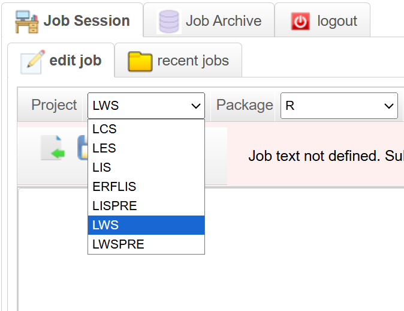

# Method 2 - `read.LIS()`

The second method, the `read.LIS()` function has a less automated yet robust approach on importing the data.

This method requires handling each country-year file separately by level. The imported datasets are then appended into a single data.frame, rather than being stored as a list.

Despite being superseded in most workflows, this function is still useful in specific cases—particularly for importing less frequently used files, such as those containing replicate weights in LWS.

```{r, eval=TRUE, echo=FALSE, include=FALSE}
library(readstata13)
source("../src/read.LIS.R")
```

```{r, eval=TRUE, echo=TRUE, results = 'hold'}
data_h <- read.LIS(c("de18h", "es18h")) # Import h-level data 
data_p <- read.LIS(c("de18p", "es18p")) # Import p-level data 

full_data <- merge(data_p, data_h, by = c("dname", "hid"))  
class(full_data) 
```

<br>

## Importing LWS and LCS data

To import LWS data, the syntax remains exactly the same, but again the <b>Project</b> must be changed in the drop-down menu.

{fig-align="center"}

```{r, eval=TRUE, echo=FALSE, include=FALSE}
source("../src/read.LIS_for_lws.R") 
```

```{r, eval=TRUE, echo=TRUE, results = 'hold'}
varh <- c('hid', 'dname', 'own', 'dnw', 'inum')
varp <- c('hid', 'dname', 'inum', 'ppopwgt', 'age', 'sex', 'relation', 'emp', 'ptime1')


data_h <- read.LIS(c("de17h", "es17h"), vars = varh)
data_p <- read.LIS(c("de17p", "es17p"), vars = varp)

df <- merge(data_p , data_h , by = c("dname", "hid", "inum"))

names(df)
```

```{r, eval=TRUE, echo=FALSE, include=FALSE}
source("../src/read.LIS_for_lcs.R") 
```

```{r, eval=TRUE, echo=TRUE, results = 'hold'}
varh <- c('hid', 'dname', 'own', 'hc01_t')
varp <- c('hid', 'dname', 'ppopwgt', 'age', 'sex', 'relation', 'emp', 'health1_c', 'health2_c', 'health3_c') 

data_h <- read.LIS(c("be22h", "be24h"), vars = varh)
data_p <- read.LIS(c("be22p", "be24p"), vars = varp)

df <- merge(data_p , data_h , by = c("dname", "hid"))

names(df)
```


<br>

## Importing replicate weights in LWS {#rep_wgt_in_R}

For some LWS datasets, a third file is available, identified by the suffix **r** (e.g. `us22r`). It contains columns with the so-called **replicate weights**.

Replicate weights are used to estimate the **uncertainty** of your results (standard errors, confidence intervals), not the estimates themselves. The idea is simple: instead of one weight per household, the survey provider supplies many alternative versions of the weights, each one built by resampling or re-adjusting the sample. You then compute your statistic once with the main weight (your point estimate) and once with each replicate weight. The variability across those replicate results reflects the sampling variability that standard formulas would miss under a complex survey design.

In practice, whenever a LWS user wants to include replicate weights in an analysis, they need to import the file with `read.LIS()` and merge it with the LWS microdata of the respective country and year, using the household identifier `hid`.

```{r, eval=TRUE, echo=FALSE, include=FALSE}
source("../src/read.LIS_for_lws.R") 
```

```{r, eval=TRUE, echo=TRUE, results = 'hold', message = 5, warning = FALSE} 
library(lissyrtools)
library(dplyr)

us_lws22_microdata = lissyrtools::lissyuse(
  data = c("us22"), 
  vars = c("dnw"), 
  database = 'lws' 
)

file_r <- read.LIS('us22r') # suffix 'r'

# Retrieve the data.frame from the list
us_lws22_microdata_df = us_lws22_microdata[[1]]

lws_us22 <- us_lws22_microdata_df %>% 
  left_join(file_r, by = "hid")

length(names(lws_us22))  
```


The merged data frame contains all the original columns plus the replicate weight columns, which is why the number of columns is much larger than in the original microdata.


