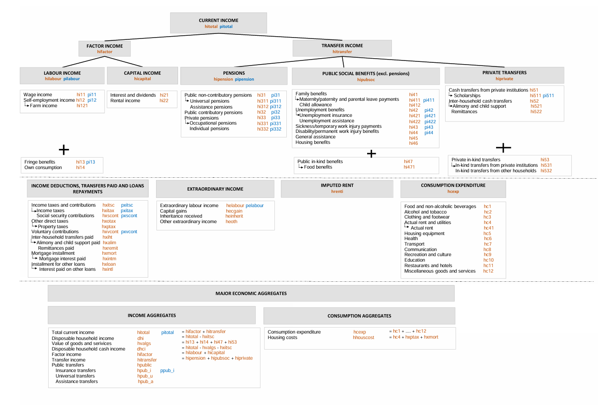
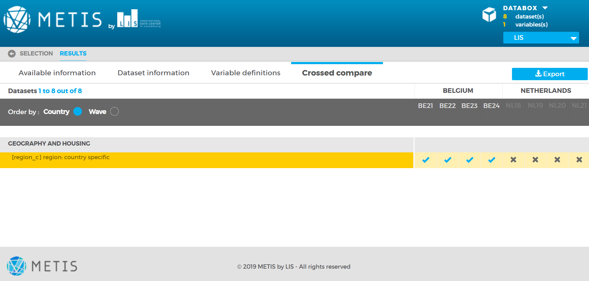
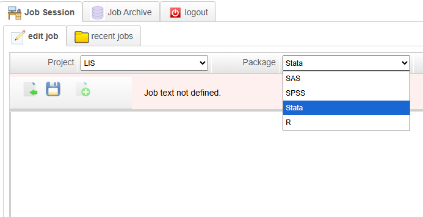

# Datasets & Country Codes

LIS provides a [downloadable file](https://www.lisdatacenter.org/wp-content/uploads/files/resources_datasets.txt?) listing all available datasets in the LIS/LWS/LCS databases:

The file includes, among other information:

- country codes,
- available years,
- survey names,
- dataset identifiers, and
- database membership (LIS/LWS/LCS).

It can be useful for quickly checking dataset availability or constructing loops programmatically in Stata.


::: callout-tip
Survey changes across different periods may introduce breaks in consistency, potentially affecting the availability, content, or coverage of certain variables. For more information on within-country comparability across time, we suggest users explore the [**Compare.it**](https://comparability.lisdatacenter.org/shiny/comparability/){target="_blank"} tool.
:::

<br>

# Variables

All datasets at a given level share the same set of variables. In practice, this means that even if a variable is not available in the original data provided to LIS, it will still appear in the dataset structure, filled entirely with missing values or zeros.

In addition to [METIS](https://www.lisdatacenter.org/frontend#/home), LIS provides three separate variable lists, one for [LIS](https://www.lisdatacenter.org/wp-content/uploads/files/data-lis-variables.pdf), one for [LWS](https://www.lisdatacenter.org/wp-content/uploads/files/data-lws-variables.pdf), and one for [LCS](https://www.lisdatacenter.org/wp-content/uploads/files/resources_BetaLCS_varlist.pdf). These allow you to explore the available variables and make sure you do not overlook any related to your topic of interest.
<!-- the lcs link is likely to be changed. Please update afterwards. -->

<br>

[{fig-align="center"}](https://www.lisdatacenter.org/wp-content/uploads/files/data-lis-variables.pdf)

<br>


## Availability

Before starting an analysis, it is often useful to assess whether the necessary variables are sufficiently available across countries and time.

One convenient way to do this is to go to **METIS** and select the variables and datasets of interest. After pressing **RESULTS**, you will see a tab named **Crossed compare**. There you will find all the availability information regarding the variables, countries and respective years.


{fig-align="center"}

<br>

## Notes

Some variables are accompanied by notes. These may reflect:

<ul>

<li>

changes in definition across years,

<li>

limitations in coverage,

<li>

the use of alternative weighting variables, or

<li>

other dataset-specific considerations highlighted by LIS.

</ul>

A convenient way to inspect all notes at once is to switch back to the <b>Stata Package</b> in LISSY.

{fig-align="center"}

```{r, include=FALSE}
source("../src/stata_machine.R")
library(Statamarkdown)
stataexe <- get_stata_machine_path()
knitr::opts_chunk$set(engine.path=list(stata=stataexe))
```

```{stata, echo = FALSE, results = "hide", collectcode = TRUE}
do "../src/lissyuse.do"
```

Once this setup is complete, all notes for a given country series can be retrieved as follows:

```{stata, eval =TRUE, echo=TRUE, class.output = "foldable"}
qui lissyuse, iso2(se) from(2018)
notes
```

